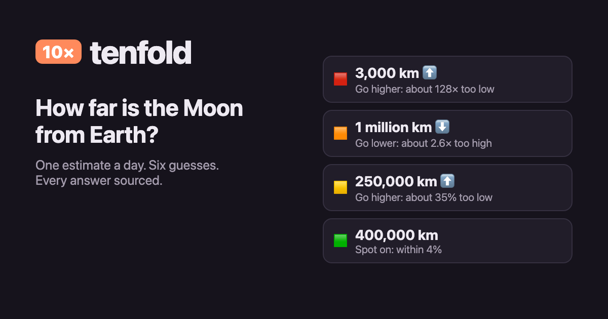

# tenfold

[](https://github.com/SAMARTHJAISWAL/tenfold/actions/workflows/ci.yml)
[](https://samarthjaiswal.github.io/tenfold/)
[](LICENSE)

**One estimate a day.** How far is the Moon? How many cells are in your body? How many ways can you shuffle a deck of cards? You get six guesses, and after each one you learn which way to go and how many times off you are.

**[▶ Play today's question](https://samarthjaiswal.github.io/tenfold/)**. There's no sign-up and no ads, and it works on any phone.

[](https://samarthjaiswal.github.io/tenfold/)

## How to play

Type a number however you'd say it: `4200`, `4,200`, `2.5 million`, `3e9`, `10^20` or even `3 crore`. After each guess you see:

| | |
|---|---|
| 🟩 | within 10% of the answer: you win |
| 🟨 | within 2× |
| 🟧 | within 10× |
| 🟥 | more than 10× off |

…plus an arrow telling you to go higher or lower, and roughly how far ("about 128× too low", "35% too high"). Your guesses appear on a logarithmic number line, so you can see yourself closing in.

When you finish, you get the answer, a sentence of context, the source, and a spoiler-free result to share:

```
tenfold #2 4/6
⬆️🟥 ⬇️🟧 ⬆️🟨 🟩
https://samarthjaiswal.github.io/tenfold/
```

A new question unlocks at midnight in your time zone. Past days can be replayed as practice from the 📅 menu, and your streak and stats stay on your device.

## Every answer is sourced, and checked

Trivia is only fun if the answers are right. Each question in [`data/questions.json`](data/questions.json) carries:

- **the answer** and its unit;
- **a source page**, usually Wikipedia;
- **an `evidence` string**: the figure exactly as that page states it.

[`scripts/check-sources.mjs`](scripts/check-sources.mjs) downloads every source and confirms the evidence appears on the page. CI runs it on every change, and a scheduled job runs it every month in case a page is edited. When I first wrote the questions, the check caught ten figures that no longer matched their sources: rounded numbers, revised measurements and moved facts. All ten were fixed or replaced before launch. All 62 are confirmed today.

## Add a question

The best questions have a surprising answer that a curious person could still reason their way towards. To suggest one:

- open a ["Suggest a question" issue](https://github.com/SAMARTHJAISWAL/tenfold/issues/new?template=question.yml), or
- add an entry to the end of `data/questions.json` and open a pull request:

```json
{
  "id": "piano-keys",
  "q": "How many keys does a standard modern piano have?",
  "answer": 88,
  "unit": "keys",
  "evidence": "88 keys",
  "source": "https://en.wikipedia.org/wiki/Piano",
  "note": "52 white keys and 36 black ones, spanning a little over seven octaves."
}
```

Add new questions at the end. Day *N* always shows the *N*th question, so adding to the end never changes a past day. The tests check that every entry is well formed, and `npm run check-sources` checks your evidence.

## How it works

- [`src/numbers.js`](src/numbers.js) reads numbers the way people write them. It handles thousands separators, scientific notation, `× 10^`, and words from "thousand" to "decillion", plus lakh and crore. It also writes them back in words ("8.1 billion", "4.3 × 10^19").
- [`src/game.js`](src/game.js) holds the rules:
  - judging each guess by how many times off it is;
  - the daily schedule, which counts calendar days from launch in your local time;
  - the share text;
  - streak bookkeeping.
- [`web/`](web) is the page. It uses plain ES modules, with no framework, no bundler and no dependencies, and loads in one round trip.
- **Privacy.** There are no accounts, cookies or analytics. Your games are stored in your own browser's `localStorage`.

## Run it locally

```sh
npm test               # rules, number parsing, schedule and question checks (Node's built-in test runner)
npm run check-sources  # confirm every answer on its source page (needs network)
npm run build          # the static site, into _site/
python3 -m http.server --directory _site
```

## License

[MIT](LICENSE)
